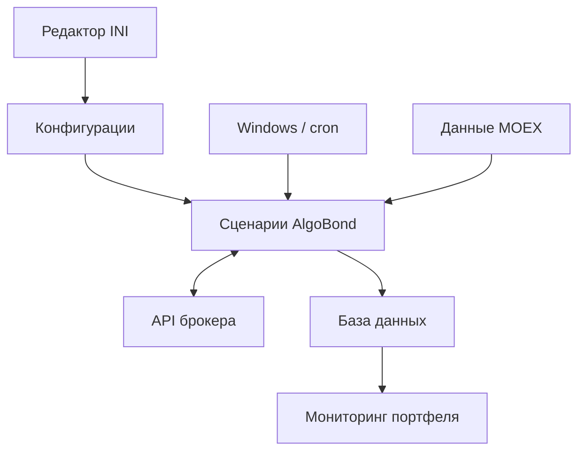
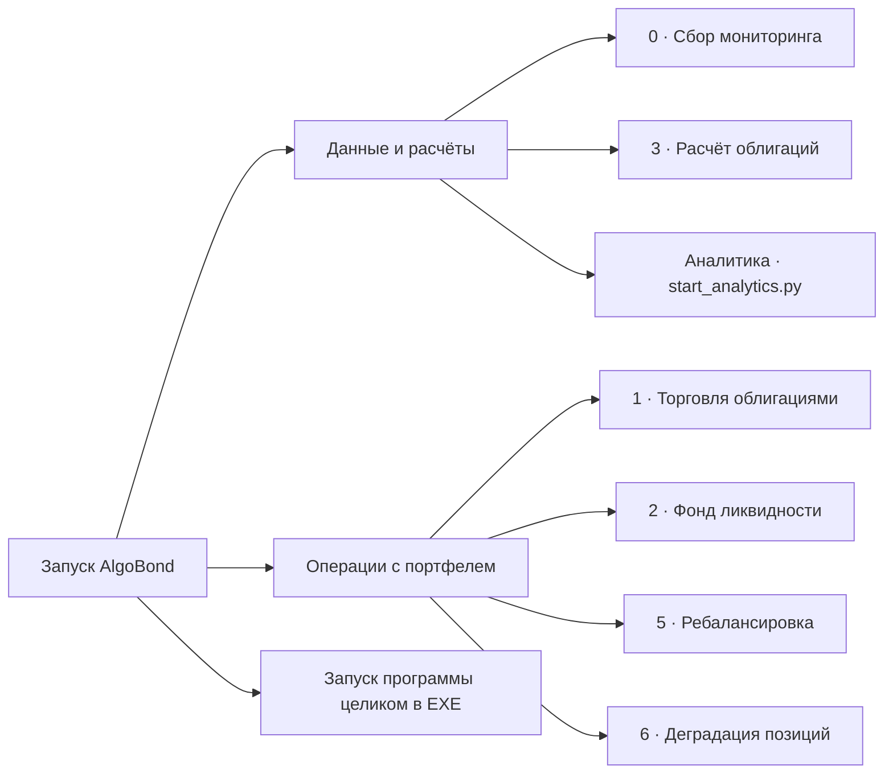

# AlgoBond

AlgoBond — приложение на Python для анализа облигаций, управления портфелем через API брокеров и просмотра сохранённой истории счетов. Параметры подключения и стратегии задаются отдельными INI-файлами. Локальный веб-интерфейс объединяет мониторинг портфеля, редактор конфигураций и управление регламентными запусками.

В проекте реализованы сбор данных у брокеров, расчёт и отбор облигаций по данным Московской биржи, торговые сценарии, ребалансировка, обработка деградирующих позиций и управление фондом ликвидности. Для хранения предусмотрены SQLite, PostgreSQL и ClickHouse.

Версия торгового ядра задаётся в [`libs/algobond_version.py`](libs/algobond_version.py).

Условия использования и распространения проекта приведены в [лицензионном соглашении](LICENSE.md).

## Быстрый запуск в Windows

<a id="quick-start"></a>

Установите Python 3.10 или новее и дважды щёлкните по [launch_algobond_ui.cmd](https://github.com/kimkarus/AlgoBond/blob/main/launch_algobond_ui.cmd) в распакованной папке AlgoBond. В браузере откроется локальный веб-интерфейс.

- **Конфигурации** — создавайте, редактируйте и проверяйте INI-профили счетов и настройки стратегии.
- **Мониторинг** — просматривайте сохранённые снимки портфеля и историю счетов из настроенной базы данных.
- **Автозапуски** — запускайте выбранные сценарии вручную, настраивайте расписание и проверяйте результат в журнале задания.
- **Логи** — просматривайте ошибки, отладочные сообщения и записи торговых операций.

Лицензии `monitor` соответствует сборка MONITOR (`start_algobond_monitor.exe`). Она предназначена для сбора данных Московской биржи (MOEX), котировок и сведений о брокерских портфелях с сохранением в настроенную базу данных. Раздел «Мониторинг» читает сохранённые данные и отображает их в веб-интерфейсе.

При запуске из исходного кода сначала установите [зависимости проекта](#installation).

## Мобильное приложение для Android

Мобильное приложение AlgoBond для Android устанавливается и работает самостоятельно. Оно **не связано с десктопной версией AlgoBond**. Приложение опубликовано в RuStore и Google Play.

- [Скачать в RuStore](https://algobond.ru/go/rustore-mobilnaya-versiya-algobond/)
- [Скачать в Google Play](https://algobond.ru/go/google-play-mobilnaya-versiya-algobond/)

## Содержание

- [Быстрый запуск в Windows](#quick-start)
- [Возможности и порядок работы](#workflow)
- [Сценарии AlgoBond](#scenarios)
- [Структура проекта](#structure)
- [Установка в Windows и Linux](#installation)
- [Первый запуск](#first-run)
- [Файлы конфигураций](#configuration)
- [Подключение брокеров](#brokers)
- [Настройка стратегии](#strategy)
- [Интервалы погашения и этапы](#stages)
- [Лимитная продажа при ребалансировке](#rebalancing-limit-orders)
- [Ликвидность и расписание стратегии](#liquidity)
- [Настройка базы данных](#database)
- [Работа с веб-интерфейсом](#web)
- [Чат технической поддержки](#support)
- [Редактор конфигураций](#editor)
- [Мониторинг одного и нескольких счетов](#monitoring)
- [Запуск сценариев из командной строки](#cli)
- [Настройка автозапусков](#autostart)
- [Файлы инструментов и результатов](#data)
- [Логи AlgoBond](#logs)
- [Диагностика и типовые ситуации](#diagnostics)
- [Автоматические проверки](#tests)
- [Хранение настроек и резервное копирование](#backup)

<a id="workflow"></a>

## Возможности и порядок работы

| Задача | Возможности |
| --- | --- |
| Подключение к брокерам | Адаптеры Finam, Т-Инвестиций, Alor и БКС |
| Анализ облигаций | Данные MOEX, фильтры торговых досок, сроков до погашения, цены, купона и расчётных показателей |
| Управление портфелем | Ограничение доли облигаций, размера позиции, распределение по срокам, условия входа и выхода |
| Торговля | Исполнение сценариев через API подключённого брокера |
| Ребалансировка | Обработка позиций по параметрам стратегии и интервалов |
| Деградация | Обработка позиций, соответствующих настроенным условиям снижения цены |
| Ликвидность | Отдельные дневные и недельные сценарии фонда ликвидности |
| История | Сохранение состояния счёта, состава портфеля и аналитики в базе данных |
| Мониторинг | Последний сохранённый снимок, история, таблицы, графики и совместный просмотр нескольких счетов |
| Редактор | Создание и копирование INI, поля и переключатели, интервалы, проверка и резервные копии |
| Автозапуски | Windows Task Scheduler и cron Linux, ручной запуск, журналы, включение и удаление заданий |



Обычный рабочий процесс:

1. Подготовить виртуальное окружение Python.
2. Создать INI нужного счёта в папке мониторинга или торговли.
3. Заполнить реквизиты брокера и параметры стратегии.
4. При необходимости настроить сохранение в базу данных.
5. Выполнить расчёт и нужный сценарий вручную.
6. Проверить результаты в базе и веб-мониторинге.
7. Создать регламентное задание для повторяющихся запусков.

Торговля, ребалансировка, деградация и управление ликвидностью используют подключённый брокерский счёт и могут выставлять заявки. Открытие веб-формы и сохранение INI сами по себе эти сценарии не запускают.

<a id="scenarios"></a>

## Сценарии AlgoBond



Коды на схеме относятся к отдельным режимам EXE. Для исходников доступны самостоятельные команды. [Запуск сценариев из командной строки](#cli)

<a id="structure"></a>

## Структура проекта

Все пути ниже указаны относительно корня репозитория.

| Путь | Назначение |
| --- | --- |
| `config_demo.ini` | Образец структуры конфигурации |
| `algobond-logo-blue.png` | Логотип веб-интерфейса |
| `requirements.txt` | Основные зависимости приложения |
| `requirements_full_with_versions.txt` | Развёрнутый список пакетов окружения, включая инструменты разработки и сборки |
| `start_dashboard.py` | Единая веб-форма |
| `dashboard.html` | Главная страница и интерфейс мониторинга |
| `start_config_editor.py` | Самостоятельный запуск редактора INI |
| `start_autostart.py` | Прямой вход в управление автозапусками |
| `autostart.html` | Интерфейс расписаний и заданий |
| `algobond_monitor.py` | Чтение базы для веб-мониторинга |
| `algobond_autostart.py` | Менеджер заданий, генерация пакетов и запуск процессов |
| `start_monitoring.py` | Получение данных у брокеров для мониторинга |
| `start_calculate.py` | Расчётный сценарий |
| `start_trading.py` | Торговля облигациями |
| `start_rebalancing.py` | Ребалансировка |
| `start_degradating.py` | Обработка деградирующих позиций |
| `start_liquidity_fund.py` | Работа с фондом ликвидности |
| `start_analytics.py` | Запуск аналитики |
| `start_algobond*.py` | Интерактивные варианты запуска программы |
| `libs/configs/` | Чтение INI и представление параметров |
| `libs/analyzer/` | Подготовка данных и выполнение сценариев |
| `libs/brokers/` | Общий слой работы с брокерскими данными |
| `libs/interfaces/brokers/` | Брокерские адаптеры и API |
| `libs/interfaces/databases/` | Провайдер и адаптеры баз данных |
| `libs/interfaces/platforms/` | Интеграции с торговыми платформами |
| `libs/common/` | Общие функции и торговые операции |
| `data/configs/accounts/monitoring/` | Профили сборщика мониторинга |
| `data/configs/accounts/trading/` | Профили торговых сценариев |
| `data/configs/editor_backups/` | Резервные копии, создаваемые редактором |
| `data/algobond.db` | Локальная база SQLite |
| `data/MOEX/` | Биржевые справочники |
| `data/calculations/MOEX/` | Расчётные CSV-файлы |
| `data/parametres/` | Списки инструментов и служебные параметры |
| `data/autostart/` | Описания заданий, статусы, журналы и архивы |
| `diagnose_monitoring.py` | Диагностика импортов и подключения к базе |
| `tests/` | Автоматические проверки |

Имена каталогов `parametres` и файлов `degradating`, `symbols_excepltion`, `symbols_low_raiting` используются именно в таком написании. Сохраняйте их при переносе проекта и настройке путей.

<a id="installation"></a>

## Установка в Windows и Linux

Готовую к запуску копию торгового ядра AlgoBond можно получить на странице [«Сравнение версий»](https://algobond.ru/sravnenie-versij/).

### Что требуется

- Python 3.10 или новее для веб-интерфейса и менеджера автозапусков. Для запуска из исходного кода подготовьте виртуальное окружение. Примеры Windows ниже используют Python 3.10.
- Современный браузер для веб-интерфейса.
- Доступ к API брокера и данным MOEX для соответствующих сценариев.
- Реквизиты брокера и, для лицензируемого варианта запуска, ключ программы.
- SQLite либо доступный сервер PostgreSQL / ClickHouse для сохранения и просмотра истории.
- Для регламентных запусков — Windows Task Scheduler или установленный cron Linux.

<a id="windows-exe"></a>

### Windows: запуск готовой сборки

Если вы используете готовую лицензируемую сборку AlgoBond для Windows, запускайте сценарии через входящий в неё файл `start_algobond_*.exe`, соответствующий вашему варианту лицензии. Распакуйте сборку и запускайте EXE из её корневой папки рядом с `data`. Профили для запуска через EXE хранятся в `data/configs/accounts/trading/`. Укажите лицензионный ключ в параметре `license_key` секции `[program]` нужного INI.

Например, чтобы выполнить расчёт по одному профилю в сборке FULL, из папки сборки выполните в `cmd.exe` следующую команду.

```bat
start_algobond_full.exe 3 "" "" "" "./data/configs/accounts/trading/account_001.ini"
```

Сами EXE запускаются без установки Python. Чтобы открыть веб-интерфейс готовой сборки, воспользуйтесь [быстрым запуском](#quick-start). Выбор сборки в форме описан в разделе [«Настройка автозапусков»](#autostart).

### Установка из исходного кода

Для установки из исходного кода скачайте репозиторий через **Code → Download ZIP** либо склонируйте его обычным способом. Распакуйте проект и откройте терминал в каталоге, содержащем `config_demo.ini` и скрипты `start_*.py`.

### Windows: создание окружения

В PowerShell из корня проекта:

```powershell
py -3.10 -m venv .venv
.\.venv\Scripts\python.exe -m pip install --upgrade pip
.\.venv\Scripts\python.exe -m pip install -r requirements.txt
.\.venv\Scripts\python.exe -m pip check
```

Интерпретатор можно вызывать полным относительным путём без активации окружения:

```powershell
.\.venv\Scripts\python.exe -B start_dashboard.py
```

Если политика PowerShell разрешает скрипты активации, можно активировать окружение:

```powershell
.\.venv\Scripts\Activate.ps1
python --version
```

Альтернатива в `cmd.exe`:

```bat
.venv\Scripts\activate.bat
python --version
```

### Linux: создание окружения

Из корня проекта:

```bash
python3 --version
python3 -m venv .venv
./.venv/bin/python -m pip install --upgrade pip
./.venv/bin/python -m pip install -r requirements.txt
./.venv/bin/python -m pip check
```

Убедитесь, что `python3` соответствует нужной версии. Для активации:

```bash
source .venv/bin/activate
python --version
```

Прямой запуск без активации:

```bash
./.venv/bin/python -B start_dashboard.py
```

**В последующих примерах `python` означает интерпретатор виртуального окружения проекта.** Если окружение не активировано, заменяйте его на `.\.venv\Scripts\python.exe` в Windows или `./.venv/bin/python` в Linux.

### Зависимости отдельных компонентов

Веб-сервер, форма редактора и менеджер автозапусков используют стандартную библиотеку Python. Клиентский архив содержит готовое HTML-руководство для раздела «О программе». При запуске из исходного кода руководство отображается с помощью `markdown-it-py`. Эта библиотека и зависимости для чтения базы и выполнения брокерских сценариев перечислены в `requirements.txt`.

Мониторинг читает SQLite и ClickHouse через стандартную библиотеку Python. Для PostgreSQL он использует `pg8000`. Этот драйвер входит в клиентский ZIP. Для запуска брокерских сценариев из исходного кода установите зависимости из `requirements.txt`.

`requirements_full_with_versions.txt` содержит также пакеты для Windows, мобильной среды, упаковки и разработки. Для обычной установки используйте основной `requirements.txt`; полный файл служит перечнем расширенного окружения.

### Рабочие каталоги

Если рабочие папки отсутствуют, создайте их до первого запуска сборщика или расчёта.

PowerShell:

```powershell
New-Item -ItemType Directory -Force -Path data/configs/accounts/monitoring, data/configs/accounts/trading, data/calculations/MOEX, data/MOEX, data/parametres, data/logs
```

Linux:

```bash
mkdir -p data/configs/accounts/monitoring data/configs/accounts/trading
mkdir -p data/calculations/MOEX data/MOEX data/parametres data/logs
```

<a id="first-run"></a>

## Первый запуск

### 1. Откройте единую форму

```bash
python -B start_dashboard.py
```

В Windows доступен [быстрый запуск](#quick-start). Лаунчер использует `.venv` рядом со скриптом, если она есть. Иначе он ищет Python через `py` и `PATH`.

В консоли появится адрес локального приложения. Браузер откроется автоматически; при необходимости скопируйте напечатанную ссылку целиком, включая фрагмент `#token=...`.

### 2. Создайте профиль

1. На главной странице откройте редактор конфигураций.
2. Выберите папку «Мониторинг» для сбора данных либо «Торговля» для торгового сценария.
3. Нажмите «Новый профиль» и задайте имя, например `account_001.ini`.
4. Заполните брокера, токен, идентификаторы счёта и имя портфеля.
5. Настройте стратегию и, при необходимости, базу данных.
6. Выполните проверку и сохраните профиль.

Новый профиль создаётся выключенным. После заполнения реквизитов установите `active = 1` для обработки брокерскими сценариями.

### 3. Подготовьте данные

При работе с готовой сборкой для Windows используйте [запуск через EXE](#windows-exe). Команды ниже предназначены для запуска из исходного кода.

Для расчёта:

```bash
python -B start_calculate.py
```

Для сохранения состояния профилей из папки мониторинга:

```bash
python -B start_monitoring.py
```

Для сохранения истории в профиле должна быть заполнена секция `[database]`.

### 4. Откройте портфель

В разделе «Мониторинг портфеля» выберите нужный профиль с базой данных и подключитесь. Список счетов ограничивается `client.login` выбранных INI. Если история ещё не записана сборщиком, сначала выполните сбор данных.

### 5. Настройте торговый запуск

Для торговли используйте отдельный профиль в `data/configs/accounts/trading/`. Проверьте его параметры в редакторе, выполните нужный сценарий вручную, затем настройте расписание в разделе «Автозапуски».

<a id="configuration"></a>

## Файлы конфигураций

### Папки и выбор профилей

| Папка | Использование |
| --- | --- |
| `data/configs/accounts/monitoring/` | `start_monitoring.py`; приоритетная папка для `start_calculate.py` |
| `data/configs/accounts/trading/` | Торговля, ребалансировка, деградация, ликвидность, аналитика и интерактивные варианты запуска |

В каждой папке может быть несколько INI. Профиль описывает реквизиты подключения и параметры обработки конкретного счёта. Имена файлов выбираются пользователем, например `monitor_account.ini` и `trade_account.ini`.

Скрипты брокерских сценариев обрабатывают активные профили. Фильтры командной строки дополнительно ограничивают список по брокеру, клиенту и логину. В веб-мониторинге активность профиля не заменяет настройку базы: для просмотра важны секция `[database]`, корректный `login` и существующие записи.

Храните в `accounts` рабочие INI. Резервные копии редактора находятся в отдельном каталоге `data/configs/editor_backups/`.

### Формат INI

- Кодировка — UTF-8. При создании файла вручную используйте UTF-8 без BOM; редактор сохраняет кодировку существующего файла.
- Секции и ключи задаются в формате `ключ = значение`.
- Числа записываются с точкой: `0.13`, `2.5`.
- Для логических параметров используйте `True` и `False`.
- Даты — `YYYY-MM-DD`, дата со временем — `YYYY-MM-DD HH:MM:SS`, когда поле требует время.
- Комментарии размещайте отдельными строками, начиная с `;` или `#`.
- Кавычки вокруг токенов, логинов и чисел не нужны: в INI они могут стать частью значения.
- Для буквального знака `%` при ручном редактировании учитывайте интерполяцию `ConfigParser`: используется `%%`. Процентные настройки стратегии задаются числами без знака `%`.

### Пример профиля

Ниже демонстрационный профиль Т-Инвестиций с SQLite. Значения стратегии иллюстрируют формат записи. Замените заполнители реквизитами своего счёта; профиль оставлен выключенным.

```ini
[program]
license_key = REPLACE_WITH_LICENSE_KEY

[client]
active = 0
client_id = client_001
login = ACCOUNT_LOGIN
client_name = Bond portfolio
broker_name = Tinkoff
broker_company = T-Investments
broker_server = TINKOFF
broker_type_api = grpc
type_account = Bonds
token = REPLACE_WITH_BROKER_TOKEN
token_grpc =
account_id =
account_id_grpc =
enable_autofollow_strategy = False
strategy_id =

[database]
type = sqlite3
name = algobond
address =
port = 0
login =
password =
storage_depth_days = 365

[settings]
boards = TQCB,TQIR,TQOB
portfolio_max_percent_bonds = 80
k_count = 1
p_risk = 2
order_open_percent = 100
order_close_percent = 100
use_getting_current_price = False
use_checking_order_book = False
low_price = 65
low_couponpercent = 5
tax = 0.13
max_count_lot = 200
broker_comission_perdeal = 50
days_planning_min = 5
days_planning_max = 365
bonds_config = 5-90:25;90-180:35;180-365:40
enable_rebalancing_by_config = False
enable_sell_degradating_position = False
percent_degradating_position_for_sell = 5
liquidity_fund = TMON
enable_liquidity_fund_weekend = False
enable_liquidity_fund_everyday = False
enable_liquidity_fund_leverage = False
financial_support_for_liquidity_fund = 0
untouchable_balance_of_funds = 0
schedule_hour_start_trading = 10
schedule_hour_end_trading = 17
schedule_hour_start_rebalancing = 10
schedule_hour_end_rebalancing = 17
schedule_hour_start_degradating = 10
schedule_hour_end_degradating = 17
close_all = False
```

Если база не используется, удалите секцию `[database]` целиком. Пустая секция не означает отключение хранения.

### Секция `[program]`

| Ключ | Назначение |
| --- | --- |
| `license_key` | Ключ активации для соответствующего лицензируемого варианта программы |

Для интерактивных вариантов выбирайте точку входа, соответствующую типу ключа. Ограничения варианта загружаются через механизм лицензирования программы.

### Секция `[client]`

| Ключ | Назначение |
| --- | --- |
| `active` | `1` — профиль участвует в обработке брокерскими сценариями; `0` — выключен |
| `client_id` | Пользовательский идентификатор клиента; участвует в фильтрации и сохранении данных |
| `login` | Идентификатор профиля / счёта, используемый адаптером, локальными путями и записями базы |
| `client_name` | Читаемое имя портфеля |
| `broker_name` | Код адаптера: `Finam`, `Tinkoff`, `Alor`, `BCS` |
| `broker_type_api` | Параметр вида API; для показанных ниже gRPC-подключений — `grpc` |
| `token` | Основной токен брокера; конкретный тип определяется адаптером |
| `token_grpc` | Токен gRPC, используемый адаптером Finam |
| `account_id` | Идентификатор счёта / портфеля, когда он требуется адаптером |
| `account_id_grpc` | Идентификатор счёта gRPC, когда он требуется адаптером |
| `broker_company` | Название компании, сохраняемое в аналитике и базе |
| `broker_server` | Название сервера / источника, сохраняемое в базе |
| `type_account` | Тип обрабатываемых инструментов; для облигационной стратегии — `Bonds` |
| `enable_autofollow_strategy` | Подключение логики стратегии автоследования в поддерживающем её адаптере |
| `strategy_id` | Идентификатор стратегии автоследования |
| `enable_x_app_name` | Дополнительный параметр идентификации приложения в поддерживающем его адаптере / варианте запуска |

`client.login` и `database.login` имеют разное назначение: первый относится к профилю счёта, второй — к пользователю СУБД.

Меняйте `client_id`, `login`, `broker_company` и `broker_server` осознанно: эти значения используются для идентификации сохранённых данных. Новые значения могут образовать отдельную историю в базе.

<a id="brokers"></a>

## Подключение брокеров

Реквизиты получают в личном кабинете или сервисе API соответствующего брокера. В INI переносятся значения, ожидаемые конкретным адаптером. Настройка `broker_name` должна содержать код из таблицы, даже если публичное название брокера отличается.

| Подключение | `broker_name` | Основные параметры | Код адаптера |
| --- | --- | --- | --- |
| Finam | `Finam` | `broker_type_api = grpc`, `token_grpc`, `login`, при необходимости поля счёта | `libs/interfaces/brokers/finam/grpc/` |
| Т-Инвестиции | `Tinkoff` | `broker_type_api = grpc`, `token`; параметры стратегии — при автоследовании | `libs/interfaces/brokers/tinkoff/` |
| Alor | `Alor` | `token` как refresh token; реквизиты портфеля определяются адаптером | `libs/interfaces/brokers/alor/` |
| БКС | `BCS` | `token` как refresh token; параметры подключения адаптера БКС | `libs/interfaces/brokers/bcs/rest/` |

Поле `token` входит в общую структуру профиля. Для Finam gRPC оно может быть пустым, если подключение использует заполненный `token_grpc`.


Начните с профиля, для которого адаптер однозначно определяет нужный счёт. Проверяйте выданные брокером идентификаторы и доступность операций для токена до назначения регулярных торговых запусков.

<a id="strategy"></a>

## Настройка стратегии

Параметры ниже относятся к секции `[settings]`. Поля, отсутствующие в INI, получают значения из кода. При настройке конкретного портфеля задавайте значимые параметры явно.

### Портфель и размер позиции

| Ключ | Смысл и формат |
| --- | --- |
| `portfolio_max_percent_bonds` | Предельная доля облигаций в процентах от портфеля |
| `p_risk` | Параметр доли позиции в процентах; не является гарантированным пределом убытка |
| `k_count` | Множитель расчётного количества лотов |
| `max_count_lot` | Количественное ограничение позиции в логике подбора / покупки |
| `order_open_percent` | Доля расчётного объёма открывающей операции в процентах |
| `order_close_percent` | Доля расчётного объёма закрывающей операции в процентах |
| `k_share_balance` | Коэффициент доступной доли баланса в расчётах стратегии |
| `untouchable_balance_of_funds` | Денежный резерв для сценариев, использующих этот параметр |

Для задания предела доли облигаций используйте **`portfolio_max_percent_bonds`**. `portfolio_percent_bonds` используется ядром как показатель текущего состояния портфеля.

Чтобы выключить профиль, установите `[client] active = 0`. Нулевые `order_open_percent` и `order_close_percent` не используются как универсальный выключатель операций.

### Отбор облигаций и расчётные параметры

| Ключ | Назначение |
| --- | --- |
| `boards` | Торговые доски через запятую, например `TQCB,TQIR,TQOB`, без пробелов между кодами |
| `days_planning_min` | Нижняя граница числа дней до погашения |
| `days_planning_max` | Верхняя граница числа дней до погашения |
| `low_price` | Нижний порог цены в правилах отбора инструментов |
| `low_couponpercent` | Нижний порог купонной ставки |
| `tax` | Коэффициент налогового удержания для расчётов, например `0.13` |
| `broker_comission_perdeal` | Фиксированный размер комиссии, учитываемый расчётами; имя ключа сохраняет написание `comission` |
| `target_percent_peryear` | Целевой годовой показатель в расчётных параметрах |
| `target_max_date` | Целевая дата со временем: `YYYY-MM-DD HH:MM:SS` |
| `enable_profitability` | Включение соответствующего отбора по доходности |
| `profitability` | Порог доходности для этого отбора |
| `use_getting_current_price` | Дополнительное получение текущей цены перед операцией |
| `use_checking_order_book` | Проверка биржевого стакана в соответствующей торговой ветке |
| `enable_corrention_lots_by_order_book` | Параметр коррекции количества лотов по стакану; написание ключа соответствует коду |
| `percent_diff_prevprice` | Процентное отклонение для сравнения цены с предыдущим значением |
| `percent_lot_buy` | Процентный коэффициент объёма покупки |
| `percent_lot_sell` | Процентный коэффициент объёма продажи |
| `percent_price_diff_stop` | Порог отклонения цены в проверках перед открытием позиции |

`tax` и параметры комиссий задают допущения расчёта. Значения примеров не подставляются автоматически из условий брокерского тарифа.

### Ребалансировка и обработка снижения цены

| Ключ | Назначение |
| --- | --- |
| `enable_rebalancing_by_config` | Разрешение ребалансировки по настройкам портфеля |
| `enable_sell_degradating_position` | Разрешение обработки деградирующих позиций |
| `percent_degradating_position_for_sell` | Процентный параметр снижения цены в этом сценарии |
| `enable_target_minimum_profit_diff_sell` | Включение дополнительного условия прибыльного выхода |
| `percent_target_minimum_profit_diff_sell` | Минимальное процентное различие для соответствующего условия выхода |
| `percent_target_minimum_profit_price_sell` | Ценовой порог для соответствующего условия выхода |
| `close_all` | Режим массового закрытия позиций в торговом сценарии; для обычной работы — `False` |

Условия операций определяются совокупностью настроек, состояния счёта, времени, данных инструмента и выбранного сценария. Запуск `start_rebalancing.py` или `start_degradating.py` не означает обязательного выставления заявки: профиль должен разрешать соответствующую обработку.

<a id="stages"></a>

## Интервалы погашения и этапы

### Базовое распределение `bonds_config`

Формат одной записи:

```text
минимум_дней-максимум_дней:доля_портфеля
```

Несколько записей разделяются `;`:

```ini
[settings]
bonds_config = 5-90:25;90-180:35;180-365:40
```

| Интервал | Доля, указанная в конфигурации |
| --- | ---: |
| 5–90 дней | 25% |
| 90–180 дней | 35% |
| 180–365 дней | 40% |

Проценты задаются числом без `%`. Редактор показывает сумму распределения и предупреждает, если она превышает 100%; значения не нормализуются автоматически.

### Порядок обработки `stages_days_planning`

Интервалы разделяются `|`:

```ini
stages_days_planning = 90-180|5-90|180-365
```

Запись задаёт очередность интервалов в предусмотренных стратегией этапах обработки. При отсутствии ключа используется диапазон `days_planning_min` — `days_planning_max`.

### Расширенное распределение `stages_bonds_config`

Формат записи с шестью полями:

```text
дни_от-дни_до:доля:p_risk:отклонение_для_покупки:цель_прибыли:дни_до_продажи
```

| Позиция | Поле | Значение в примере `90-180:35:2:3:10:5` |
| --- | --- | --- |
| 1 | Диапазон дней до погашения | 90–180 |
| 2 | Доля портфеля для интервала | 35% |
| 3 | `p_risk` для интервала | 2 |
| 4 | `target_diff_buy` | 3 |
| 5 | `target_profit_diff_sell` | 10 |
| 6 | `target_daysleft_sell` | 5 дней |

**Шестое поле — число оставшихся дней для продажи, а не процент просадки.** Порог деградации задаётся отдельно через `percent_degradating_position_for_sell`.

Внутри одного этапа записи разделяются `;`. Этапы разделяются `|`.

Один этап из трёх интервалов:

```ini
stages_bonds_config = 5-90:25:2:2:8:5;90-180:35:2:3:10:5;180-365:40:2:4:12:10
```

Два этапа:

```ini
stages_bonds_config = 5-90:50:2:2:8:5;90-180:50:2:3:10:5|180-365:100:2:4:12:10
```

Парсер также принимает седьмое поле `profitability` для интервала. Если расширенная запись отсутствует, список этапов строится на основании `bonds_config`.

Для настройки через форму откройте раздел сроков и этапов: интервалы можно добавлять строками, задавать доли и проверять итоговое распределение без ручного набора разделителей.

<a id="liquidity"></a>

## Ликвидность и расписание стратегии

### Фонд ликвидности

| Ключ | Назначение |
| --- | --- |
| `liquidity_fund` | Тикер фонда, используемого сценарием |
| `enable_liquidity_fund_weekend` | Недельный сценарий размещения / освобождения ликвидности |
| `enable_liquidity_fund_everyday` | Ежедневный сценарий |
| `enable_liquidity_fund_leverage` | Сценарий с предусмотренным обеспечением |
| `enable_liquidity_fund_profitable` | Проверка прибыльности в логике фонда |
| `financial_support_for_liquidity_fund` | Размер обеспечения для соответствующего сценария фонда |
| `count_for_open_liquidity_fund_per` | Количественный параметр открытия позиции фонда |
| `liquidity_fund_effective_rate` | Эффективная ставка в расчётах фонда |
| `liquidity_fund_target_profit` | Целевой показатель прибыли фонда |
| `broker_comission_percent_perdeal_liquidity_fund` | Комиссия в расчётах операций с фондом |
| `broker_leverage_percent_perday` | Дневная стоимость заёмных средств в расчётах |

В шаблоне встречаются примеры тикеров `FMMM`, `TMON`, `LQDT`, `BCSD`. Используемый тикер должен быть доступен подключённому счёту. Поле не ограничивается названием фонда конкретного брокера: указывайте инструмент, с которым должен работать сценарий.

Запуск:

```bash
python -B start_liquidity_fund.py
```

### Торговые часы в INI

| Сценарий | Начало | Окончание |
| --- | --- | --- |
| Торговля | `schedule_hour_start_trading` | `schedule_hour_end_trading` |
| Ребалансировка | `schedule_hour_start_rebalancing` | `schedule_hour_end_rebalancing` |
| Деградация | `schedule_hour_start_degradating` | `schedule_hour_end_degradating` |
| Недельная ликвидность | `schedule_hour_start_liquidity_weekend` | `schedule_hour_end_liquidity_weekend` |
| Дневная ликвидность | `schedule_hour_start_liquidity_everyday` | `schedule_hour_end_liquidity_everyday` |
| Ликвидность с обеспечением | `schedule_hour_start_liquidity_leverage` | `schedule_hour_end_liquidity_leverage` |

Часы задаются целыми числами от `0` до `23`. Для недельного сценария дополнительно используются:

```ini
schedule_day_start_liquidity_weekend = 5
schedule_day_end_liquidity_weekend = 1
```

Нумерация дней: понедельник — `1`, воскресенье — `7`.

Время стратегии привязано к используемому в сценарии биржевому времени; для MOEX применяется московское время. Интерактивные обёртки могут дополнительно ограничивать торговые действия рабочими днями и своим временным окном.

Расписание в INI задаёт условия, при которых **уже запущенный** сценарий может выполнить операцию. Сам процесс запускает пользователь или планировщик ОС. Например, чтобы проверять торговые условия каждые 15 минут, создайте соответствующее задание автозапуска; одних полей `schedule_hour_*` для запуска процесса недостаточно.

<a id="database"></a>

## Настройка базы данных

### Общие правила

Наличие секции `[database]` включает использование базы в профиле. Для отключения удалите секцию полностью. Поддерживаемые значения `type`:

- `sqlite3`;
- `postgresql`;
- `clickhouse`.

Сохраняйте все поля структуры, даже если часть реквизитов не используется локальной SQLite:

| Ключ | Назначение |
| --- | --- |
| `type` | Тип СУБД |
| `name` | Имя базы; для SQLite — служебное значение конфигурации |
| `address` | Адрес сервера; для SQLite может быть пустым |
| `port` | Порт сервера; для SQLite не используется |
| `login` | Пользователь базы |
| `password` | Пароль пользователя базы |
| `storage_depth_days` | Глубина хранения истории для предусмотренной адаптером очистки |

Для PostgreSQL / ClickHouse подготовьте существующую базу и учётную запись с доступом к ней. Сценарию записи нужны права на создание используемых таблиц и запись данных; просмотру — доступ на чтение. При размещении внешней СУБД разрешите соединение с компьютера, запускающего AlgoBond.

### SQLite

```ini
[database]
type = sqlite3
name = algobond
address =
port = 0
login =
password =
storage_depth_days = 365
```

Файл базы фиксирован в конфигурационном коде: **`data/algobond.db`** относительно корня проекта. Поле `name` не задаёт путь к другому SQLite-файлу.

При выполнении сценария записи SQLite использует этот файл, а необходимые таблицы подготавливаются средствами AlgoBond. Для веб-просмотра файл должен уже существовать: мониторинг не создаёт пустую базу вместо отсутствующей.

### PostgreSQL

```ini
[database]
type = postgresql
name = algobond
address = 127.0.0.1
port = 5432
login = algobond_user
password = REPLACE_WITH_DATABASE_PASSWORD
storage_depth_days = 365
```

Драйвер выбирается существующим `DatabaseProvider`. Веб-мониторинг работает через предусмотренную ветку PostgreSQL и транзакцию чтения.

### ClickHouse

```ini
[database]
type = clickhouse
name = securities_analytics
address = 127.0.0.1
port = 8123
login = algobond_user
password = REPLACE_WITH_DATABASE_PASSWORD
storage_depth_days = 365
```

Используется HTTP-интерфейс ClickHouse. В `address` указывайте имя узла или IP без `http://` и без порта: адрес запроса собирается адаптером из отдельных полей.

### Данные портфеля

| Таблица | Назначение |
| --- | --- |
| `AccountInfo` | Состояние счёта и показатели портфеля в момент записи |
| `SymbolsInfo` | Состав портфеля, позиции и их параметры |
| `PlanningSymbolInfo` | Плановые даты, погашения и аналитические показатели инструментов |

Торговое ядро может сохранять и другие расчётные таблицы. Для веб-мониторинга основными источниками служат три таблицы выше.

Одну базу можно использовать для нескольких счетов. При чтении учитываются идентификаторы счёта и источника, а не только название INI.

<a id="web"></a>

## Работа с веб-интерфейсом

### Точки входа

| Команда | Начальный раздел |
| --- | --- |
| `python -B start_dashboard.py` | Главная страница |
| `python -B start_dashboard.py --view monitor` | Мониторинг портфеля |
| `python -B start_dashboard.py --view autostart` | Автозапуски |
| `python -B start_dashboard.py --view about` | О программе и руководство по эксплуатации |
| `python -B start_autostart.py` | Автозапуски |
| `python -B start_config_editor.py` | Самостоятельный редактор |

С главной страницы можно перейти в мониторинг портфеля, редактор конфигураций, автозапуски, логи и раздел «О программе». В разделе «О программе» доступны ссылки на мобильное приложение для Android и руководство по эксплуатации из `README_GITHUB.md`.

### Параметры запуска

| Параметр | Назначение |
| --- | --- |
| `--project PATH` | Корень проекта с `config_demo.ini` и папкой `data` |
| `--port NUMBER` | Локальный порт; `0` означает автоматический выбор свободного |
| `--no-browser` | Не открывать браузер автоматически |
| `--view home` | Начать с главной страницы единой формы |
| `--view monitor` | Начать с мониторинга |
| `--view autostart` | Начать с автозапусков |
| `--view about` | Открыть раздел «О программе» |

Пример с фиксированным портом:

```bash
python -B start_dashboard.py --port 8765 --no-browser
```

Пример для проекта в другой папке:

```bash
python -B start_dashboard.py --project /path/to/kimkarus_ea_monitor_py --no-browser
```

В Windows передайте свой абсолютный путь в кавычках. Файлы `dashboard.html`, `autostart.html` и `README_GITHUB.md` должны находиться рядом со `start_dashboard.py`.

Сервер слушает `127.0.0.1`. Для доступа используется персональная ссылка с токеном текущего запуска. Перенос ссылки между устройствами не превращает локальную форму в сетевой сервис. После перезапуска приложения используйте новую ссылку из консоли.

Окно процесса веб-сервера оставляйте открытым. Для его завершения нажмите `Ctrl+C`. Закрытие вкладки браузера само по себе не завершает сервер.

<a id="support"></a>

## Чат технической поддержки

На главной странице, в мониторинге, редакторе и автозапусках доступен встроенный чат Pyrus. Он также подключён в самостоятельном редакторе. Положение и оформление определяются настройками виджета; скрипт загружается асинхронно.

Для обращения откройте чат и введите сообщение. Для работы виджета браузеру нужен доступ к Pyrus. После отправки вопроса переписка ведётся в интерфейсе чата.

<a id="editor"></a>

## Редактор конфигураций

Редактор работает с INI в папках `monitoring` и `trading`. Запуск редактора не подключается к брокеру и не исполняет торговые сценарии.

### Выбор и создание файла

1. Выберите папку профилей.
2. Найдите файл по имени, названию портфеля, логину или брокеру.
3. При необходимости используйте фильтры брокера и активности.
4. Откройте профиль либо создайте новый на основе `config_demo.ini`.

При создании нового профиля редактор очищает ключи и идентификаторы, выключает профиль и удаляет шаблонную секцию базы с заполнителями. Файл появляется на диске после сохранения.

«Дублировать» создаёт черновик с новым именем, сохраняет настройки исходного профиля и устанавливает `active = 0`. Проверьте реквизиты копии перед включением.

### Разделы формы

| Раздел | Что настраивается |
| --- | --- |
| Профиль | Брокер, API, счёт, активность, ключи |
| Стратегия и риск | Доли, размер позиции, фильтры, цена, купон, сроки |
| Сроки и этапы | Интервалы, проценты, приоритеты, расширенные параметры |
| Сделки и расписание | Объёмы операций, условия выхода, часы |
| Ликвидность | Фонд, сценарии, обеспечение, расписание |
| Хранение | Тип базы, реквизиты и связанные параметры |
| Дополнительно | Поля существующего INI, не вынесенные в основные группы |
| INI | Редактирование исходного текста |

Числовые параметры представлены полями и ползунками; флаги — переключателями. Секреты скрыты и доступны через кнопку показа.

Поля, отсутствующие в файле, отображаются со значением по умолчанию и не записываются автоматически. Кнопка сброса поля удаляет конкретный ключ и возвращает использование значения из кода. Для обязательного ключа такая операция требует восстановления значения перед сохранением.

### Сохранение

1. Измените поля.
2. Нажмите «Проверить».
3. Нажмите «Сохранить» либо `Ctrl+S`.
4. Просмотрите сравнение.
5. Подтвердите сохранение изменений.

Секреты в сравнении скрыты. При обычном редактировании сохраняются комментарии и неизвестные поля. Предыдущая версия существующего файла попадает в резервные копии:

```text
data/configs/editor_backups/monitoring/
data/configs/editor_backups/trading/
```

Если файл изменён другой программой после загрузки в форму, редактор сообщает о конфликте и сохраняет черновик для дальнейшей работы. Повторное чтение позволяет получить актуальную версию.

Для выключения загрузки подготовленных данных снимите соответствующий переключатель в форме: редактор удаляет ключ `enable_download_data_exchange`. При ручном редактировании для выключения также удаляйте этот ключ, а не записывайте строку `False`.

Изменение INI применяется при следующем чтении настроек соответствующим процессом. Уже работающий торговый процесс может продолжать использовать загруженные ранее значения.

<a id="monitoring"></a>

## Мониторинг одного и нескольких счетов

### Сбор данных и просмотр

| Действие | Что происходит |
| --- | --- |
| `start_monitoring.py` | Подключается к брокерам, обрабатывает активные профили `monitoring`, сохраняет состояние по настройкам базы |
| Раздел «Мониторинг портфеля» | Читает уже сохранённые данные из базы выбранного профиля |
| Кнопка обновления в дашборде | Повторно читает базу |

Веб-просмотр не заменяет сборщик. «Текущий снимок» — последнее записанное состояние, а не непрерывный поток брокерских котировок.

### Подключение

1. Откройте мониторинг портфеля.
2. Выберите папку «Мониторинг», «Торговля» либо смешанный режим.
3. Выберите один INI или все доступные конфигурации выбранной области.
4. Подключитесь к базе.

Для подключения нужны корректная секция `[database]` и `client.login`. Профили без базы видны в списке, но не используются как источники данных.

После подключения панель выбора сворачивается в компактную кнопку. Её можно раскрыть, чтобы изменить область или конфигурацию.

Список счетов ограничен логинами, указанными в выбранных INI. Счета с посторонними логинами из той же базы в каталог не добавляются. Если один логин соответствует нескольким вариантам счёта, учитываются дополнительные идентификаторы; валютные варианты показываются отдельно.

### Один профиль, все профили и смешанный режим

- **Один INI:** работа с конкретным источником.
- **Все конфигурации:** загрузка подходящих источников выбранной папки с общим представлением счетов.
- **Смешанный режим:** выбор профилей из обеих папок.

В общем представлении доступны:

- фильтр и поиск счетов;
- устойчивый цвет каждого счёта;
- отдельные показатели счетов;
- сводные показатели выбранных счетов;
- таблицы с группировкой по счетам;
- линии стоимости и составные столбики плановых поступлений;
- числовые подсказки на графиках при наведении курсора.

Единственный ключ счёта — `login`: отличия `client_id`, сервера, компании, типа и валюты не создают отдельные пункты каталога; история сохраняется. На одну дату используется один вариант хранения, без повторного учёта позиций. Разные валюты показываются раздельно; валютная конвертация для объединения итогов не выполняется.

Переключение между уже загруженными режимами и профилями в текущем сеансе мониторинга сохраняет данные и выбранное состояние. Для принудительного перечитывания используйте обновление. После перезагрузки страницы данные загружаются заново.

### Историческое состояние

1. Переключитесь в историю.
2. Выберите сохранённые дату и время либо используйте календарь.
3. Для общего портфеля задайте общий момент просмотра.

Исторический снимок использует состояние не позднее выбранного момента. Календарный выбор находит последнее доступное состояние до конца указанного дня. Для разных таблиц фактические моменты записи могут отличаться: интерфейс показывает даты источников и предупреждения.

При просмотре прошлого будущие позиции не подставляются вместо отсутствующих исторических данных. Если подходящего снимка таблицы нет, соответствующий блок остаётся пустым.

### Таблицы и графики

В дашборде доступны состояние счёта, позиции, плановые погашения / поступления и история. Таблицы поддерживают поиск, сортировку и постраничный просмотр. Подсказки графиков показывают дату и значение; для нескольких счетов сохраняется цветовая связь с выбранными счетами.

При старом снимке ориентируйтесь на показанную дату записи. Данные появятся после успешной работы сборщика с теми же реквизитами счёта и базы.

<a id="cli"></a>

## Запуск сценариев из командной строки

### Рабочая папка

Брокерские скрипты используют относительные пути `./data/...`. Запускайте их из корня проекта. В IDE задайте этот каталог как **Working directory**.

### Основные команды

| Задача | Команда | Папка INI | Выбор одного INI |
| --- | --- | --- | --- |
| Сбор мониторинга | `python -B start_monitoring.py` | `monitoring` | Через фильтры; отдельный путь INI не применяется |
| Расчёт | `python -B start_calculate.py` | `monitoring`; при совсем пустом каталоге — `trading` | Через фильтры |
| Торговля | `python -B start_trading.py` | `trading` | Да |
| Ребалансировка | `python -B start_rebalancing.py` | `trading` | Да |
| Деградация | `python -B start_degradating.py` | `trading` | Да |
| Фонд ликвидности | `python -B start_liquidity_fund.py` | `trading` | Через фильтры |
| Аналитика | `python -B start_analytics.py 0 "" "" ""` | `trading` | Да |

Для расчёта переход к папке `trading` зависит именно от пустоты `monitoring`: наличие в ней выключенного профиля или другого файла уже означает, что каталог не пуст.

### Позиционные аргументы

Общий порядок:

```text
python script.py ACTION BROKER CLIENT_ID LOGIN [CONFIG_PATH]
```

| Аргумент | Назначение |
| --- | --- |
| `ACTION` | Код сценария; отдельные скрипты закрепляют собственный код |
| `BROKER` | Фильтр по `client.broker_name` |
| `CLIENT_ID` | Фильтр по `client.client_id` |
| `LOGIN` | Фильтр по `client.login` |
| `CONFIG_PATH` | Один INI для скриптов, поддерживающих этот выбор |

| Скрипт | Код |
| --- | ---: |
| `start_monitoring.py` | 0 |
| `start_trading.py` | 1 |
| `start_liquidity_fund.py` | 2 |
| `start_calculate.py` | 3 |
| `start_rebalancing.py` | 5 |
| `start_degradating.py` | 6 |
| `start_analytics.py` | 0; скрипт запускает отдельный класс аналитики |

Пустые фильтры сохраняйте как отдельные пустые аргументы. Не сдвигайте логин на позицию клиента. Веб-менеджер автозапусков формирует этот список автоматически.

Примеры для Bash или `cmd.exe`, сохраняющих показанные пустые аргументы:

```bash
# Мониторинг профилей конкретного брокера
python -B start_monitoring.py 0 Tinkoff

# Мониторинг по клиенту и логину
python -B start_monitoring.py 0 Tinkoff client_001 ACCOUNT_LOGIN

# Один торговый INI
python -B start_trading.py 1 "" "" "" "./data/configs/accounts/trading/account_001.ini"

# Ребалансировка одного INI
python -B start_rebalancing.py 5 "" "" "" "./data/configs/accounts/trading/account_001.ini"

# Аналитика с сохранением всех позиций аргументов
python -B start_analytics.py 0 "" "" ""
```

Некоторые версии PowerShell иначе передают пустые аргументы внешним программам. Для такого запуска используйте форму автозапусков либо сформируйте аргументы средствами Python:

```bash
python -c "import subprocess,sys; raise SystemExit(subprocess.call([sys.executable,'-B','start_trading.py','1','','','','./data/configs/accounts/trading/account_001.ini']))"
```

Путь отдельного INI задавайте **буквально** как `./data/configs/accounts/trading/имя.ini` со слешами `/`. В поддерживающих этот параметр скриптах путь сравнивается с формируемой относительной строкой. Абсолютный путь не является равнозначной заменой.

Для `start_analytics.py` используйте полный показанный набор позиционных аргументов или запуск через менеджер автозапусков.

### Интерактивные варианты программы

| Файл | Вариант запуска |
| --- | --- |
| `start_algobond.py` | `full` |
| `start_algobond_full.py` | `full` |
| `start_algobond_monitor.py` | `monitor` |
| `start_algobond_demo.py` | `demo` |
| `start_algobond_ofz.py` | `ofz` |
| `start_algobond_trial.py` | `trial` |
| `start_algobond_trial_180.py` | `trial_180` |
| `start_algobond_android.py` | `android` |

Пример:

```bash
python -B start_algobond_full.py
```

Эти точки входа используют торговые профили, проверяют соответствие ключа варианту запуска и выводят интерактивные вопросы. Отвечайте на них в терминале. Для автоматического выполнения по расписанию используйте отдельные сценарии из таблицы выше.

`start_algobond_demo.py` выполняет предусмотренную им демонстрационную последовательность с расчётом и выводом этапов. Этот файл — самостоятельная точка входа, а не флаг песочницы для остальных торговых скриптов.

`start_testing.py` предназначен для специальной проверки брокерских данных / стакана. Автоматические тесты проекта запускаются отдельно через `unittest`.

<a id="autostart"></a>

## Настройка автозапусков

### Открытие раздела

Перейдите в «Автозапуски» из главной формы либо выполните:

```bash
python -B start_autostart.py
```

Доступны семь действий: мониторинг, торговля, ребалансировка, деградация, фонд ликвидности, расчёт и аналитика. У каждого действия показаны назначение и исходный скрипт.

### Создание конфигурации запуска

В Windows менеджер ищет сборки DEMO, FULL, OFZ, TRIAL, TRIAL_180 и MONITOR в корне проекта рядом с `data`. Режим «Авто» выбирает единственную найденную сборку. При наличии нескольких EXE укажите вариант в форме. Для лицензии `monitor` выберите MONITOR и нужное действие. Для сбора данных в базу используйте «Мониторинг у брокера» с кодом `0`.

Только DEMO открывается в консоли с вопросами и использует действие «Запуск программы целиком» без первого аргумента-кода. Остальные сборки получают штатный код выбранного действия. Для всех этих EXE используются INI из `trading`. Analytics выполняется отдельным Python-сценарием. Самому менеджеру расписаний и журналов по-прежнему нужен Python.

1. Задайте название.
2. Выберите действие.
3. Укажите все подходящие активные INI или один файл, если сценарий его поддерживает.
4. При необходимости заполните фильтры брокера, клиента и логина.
5. Выберите Windows или Linux.
6. Укажите абсолютный путь проекта на целевом компьютере.
7. Укажите существующий абсолютный путь к Python на целевом компьютере. Для локального задания форма предлагает Python из `.venv` проекта, если он есть, или Python, которым запущен интерфейс. При запуске EXE этот путь нужен менеджеру заданий.
8. Настройте расписание.
9. Выполните предпросмотр и проверьте команду, рабочую папку и перечень профилей.
10. Сохраните конфигурацию.
11. Установите задание ОС либо скачайте пакет управления.

**Сохранение описания не устанавливает задание и не запускает процесс.** Установка и ручной запуск выполняются отдельными командами.

Выбор одного INI не делает неактивный профиль активным. Для другой машины показанный в предпросмотре перечень относится к текущей копии проекта; при выполнении используются INI на целевой машине.

### Виды расписания

| Вид | Windows | Linux |
| --- | --- | --- |
| Интервал | Повторение с выбранным интервалом; первый запуск примерно через минуту после установки | Выражение cron с привязкой к часовым / суточным границам |
| Ежедневно | В выбранное время | В выбранное время |
| Дни недели | По выбранным дням | По выбранным дням |
| При запуске | При входе конкретного пользователя в Windows | `@reboot` при запуске cron |
| Пять полей cron | — | Собственное выражение времени без команды |

Расписание ОС использует местное время целевой машины. Оно действует совместно с внутренними часовыми ограничениями стратегии.

Примеры cron:

| Выражение | Назначение |
| --- | --- |
| `*/15 * * * *` | Каждые 15 минут |
| `0 10 * * 1-5` | В 10:00 с понедельника по пятницу |
| `0 */2 * * *` | В начале каждого второго часа |
| `0 0 * * *` | В полночь |

### Windows Task Scheduler

Локальная установка выполняется от учётной записи веб-приложения с параметрами `Interactive` и `Limited`. Пользователь должен быть вошедшим в Windows. Пароли не сохраняются; повышение прав автоматически не выполняется.

Если установка из формы недоступна, скачайте ZIP, распакуйте его и выполните в PowerShell на целевом компьютере:

```powershell
.\install.ps1
.\status.ps1
```

Используйте учётную запись, которой разрешена работа с планировщиком и доступ к папке проекта. Если политика не разрешает выполнение `.ps1`, можно вызвать Python-менеджер непосредственно, используя параметры из пакета.

### cron Linux

На целевой машине должны существовать проект, его INI и виртуальное окружение. Установленный cron должен разрешать работу с `crontab` текущему пользователю.

После распаковки пакета:

```bash
sh install.sh
sh status.sh
```

Установщик сохраняет резервную копию текущего crontab и изменяет только свой помеченный блок. Отдельные задания других приложений сохраняются. Для режима `@reboot` требуется поддержка этого обозначения используемой реализацией cron.

Задание использует явно указанный Python и рабочую папку проекта. Дополнительные переменные окружения, необходимые конкретному подключению, задаются в среде соответствующего пользователя ОС.

### Состав пакета

| Файл / команда | Назначение |
| --- | --- |
| `job.json` | Параметры конкретного запуска |
| `algobond_autostart.py` | Менеджер выполнения и регистрации |
| `README.txt` | Назначение, параметры, команда и инструкция задания |
| `install.ps1` / `install.sh` | Импорт описания и установка / обновление задания |
| `run.ps1` / `run.sh` | Ручной запуск без обязательной установки расписания |
| `status.ps1` / `status.sh` | Проверка задания ОС |
| `disable.ps1` / `disable.sh` | Отключение плановых запусков |
| `enable.ps1` / `enable.sh` | Включение установленного задания |
| `remove.ps1` / `remove.sh` | Удаление своего задания ОС |

Рабочие брокерские INI и их токены в ZIP задания не включаются. Они должны находиться в целевом проекте.

### Ручной запуск, изменение и удаление

На локальной карточке нажмите «Запустить сейчас» и подтвердите параметры. Процесс выполняется отдельно; результат, время и журнал отображаются в карточке. На другом компьютере используйте `run` из пакета.

Ручной запуск разрешён при отключённом расписании. Плановый запуск отключённого задания пропускается. Один экземпляр задания не запускается поверх предыдущего; разные задания имеют отдельные блокировки.

После изменения расписания или пути Python повторите установку / обновление. Для удалённой машины передайте актуальный пакет и выполните `install`. ОС и папка проекта закреплены за созданным заданием; для другого места выполнения создайте новое.

«Отключить» запрещает последующие плановые запуски. «Удалить» удаляет своё задание планировщика и переносит описание в архив. Обе операции оставляют уже работающий процесс до его завершения.

Если системная операция отклонена, форма показывает результат и предлагает пакет. При неудачном удалении остаётся карточка для завершения очистки. Для удалённого компьютера выполните `remove` там, затем подтвердите очистку карточки. Изменение в локальной форме само по себе не управляет чужим компьютером.

После установки расписание работает независимо от открытой веб-формы. Завершение `start_dashboard.py` не удаляет задания ОС.

### CLI менеджера заданий

Замените `JOB_ID` идентификатором из карточки или результата `list`:

```bash
python -B algobond_autostart.py list
python -B algobond_autostart.py inspect --id JOB_ID
python -B algobond_autostart.py run --id JOB_ID --manual
python -B algobond_autostart.py install --id JOB_ID
python -B algobond_autostart.py disable --id JOB_ID
python -B algobond_autostart.py enable --id JOB_ID
python -B algobond_autostart.py export --id JOB_ID --output job.zip
python -B algobond_autostart.py remove --id JOB_ID
```

Импорт скачанного описания:

```bash
python -B algobond_autostart.py import-definition --file /path/to/job.json --replace
python -B algobond_autostart.py install --id JOB_ID
```

При работе с другой папкой задайте `--project`. Установка разрешает плановые пуски. Повторный импорт с `--replace` сохраняет предыдущую версию описания в резервную копию.

<a id="data"></a>

## Файлы инструментов и результатов

### Расчёты и биржевые данные

Расчётные данные MOEX хранятся в `data/calculations/MOEX/`. Имя дневного расчётного файла формируется как `df_ДЕНЬ-МЕСЯЦ-ГОД.csv`. Биржевые справочники сохраняются в `data/MOEX/`, в том числе `symbols_reference.csv`.

Источники зависят от сценария: используются MOEX ISS, брокерские API и предусмотренный кодом сервис подготовленных данных. Для загрузки подготовленных данных через соответствующий сервис используется ключ программы.

Для включения предусмотренной загрузки задаётся `enable_download_data_exchange`. Для выключения удалите ключ из INI либо выключите переключатель в редакторе.

### Списки инструментов

| Файл | Назначение |
| --- | --- |
| `data/parametres/symbols_excepltion.txt` | Исключения из подбора |
| `data/parametres/symbols_whitelist.txt` | Общий белый список |
| `data/parametres/symbols_default.txt` | Служебный список дефолтных инструментов |
| `data/parametres/symbols_low_raiting.txt` | Служебный список низкого рейтинга |
| `data/parametres/symbols_degradating.txt` | Общий список деградирующих инструментов |
| `data/parametres/LOGIN/` | Списки и служебное состояние конкретного логина |

Для текстового списка используйте одну запись в строке либо разделитель `|`. Поиск учитывает тикер и названия инструмента, в том числе совпадение по части строки. Например, запись с коротким общим фрагментом может соответствовать нескольким инструментам.

Общий белый список включается параметром `enable_symbols_whitelist`. Для варианта с персональным списком задайте оба флага согласованно:

```ini
enable_symbols_whitelist = True
enable_symbols_whitelist_for_login = True
```

В таком режиме файл белого списка размещается в `data/parametres/LOGIN/symbols_whitelist.txt`. Для общего списка задайте `enable_symbols_whitelist = True` и не добавляйте ключ персонального списка.

Параметр `enable_global_path_symbols_degradating = True` переключает путь деградирующих инструментов с персональной папки логина на общий `data/parametres/`.

### Данные автозапусков

| Каталог | Содержимое |
| --- | --- |
| `data/autostart/jobs/` | Активные описания заданий |
| `data/autostart/backups/` | Предыдущие версии JSON и копии crontab |
| `data/autostart/locks/` | Межпроцессные блокировки |
| `data/autostart/status/` | Последний статус, PID, время и результат |
| `data/autostart/logs/` | Вывод запускаемых процессов |
| `data/autostart/deleted/` | Архив удалённых описаний |

Менеджер записывает описания атомарно и проверяет контрольную сумму. Для редактирования используйте форму или импорт пакета, сохраняя целостность описания.

<a id="logs"></a>

## Логи AlgoBond

В секции `[settings]` профиля или во вкладке «Логи» редактора доступны три параметра.

- `enable_logs_errors = True` записывает предупреждения и ошибки в `./logs/errors.log`.
- `enable_logs_debugs = False` по умолчанию. Значение `True` включает диагностические записи в `./logs/debug.log` и вывод в консоль.
- `enable_logs_transactions = False` по умолчанию. Значение `True` включает журнал отправки рыночных и лимитных заявок в `./logs/transactions.log`.

Через раздел «Логи» на главной странице UI можно открыть последние записи по каждому типу. Пути отсчитываются от папки AlgoBond. Файлы создаются при первой записи и дополняются в UTF-8. Каждый счёт использует параметры своего профиля.

<a id="diagnostics"></a>

## Диагностика и типовые ситуации

### Проверка окружения

```bash
python --version
python -m pip --version
python -m pip check
```

Пути Python и pip должны относиться к одному окружению проекта. При работе из IDE выберите `.venv` как интерпретатор и корень проекта как рабочую папку.

### Диагностика импортов

```bash
python -B diagnose_monitoring.py
```

Скрипт проверяет импорты в отдельных процессах и сохраняет отчёт в `data/diagnostics/`. Подключение к брокеру при этой проверке не выполняется.

Дополнительная проверка базы конкретного профиля:

```bash
python -B diagnose_monitoring.py --connect --mode monitoring --config account_001.ini
```

Для торгового профиля используйте `--mode trading`. Указывайте имя INI явно. Дополнительные параметры: `--project` для корня проекта и `--output` для файла отчёта.

### Частые вопросы

| Ситуация | Что проверить |
| --- | --- |
| Веб-форма не открылась автоматически | Используйте полную ссылку из консоли; проверьте, что процесс сервера работает |
| Запросы формы отклоняются после перезапуска | Откройте актуальную ссылку с новым токеном |
| Не найден `config_demo.ini` | Запустите форму из проекта или задайте правильный `--project` |
| Скрипт не видит папку `data` | Проверьте рабочую папку терминала / IDE |
| Профиль не участвует в брокерском сценарии | Проверьте папку, `active`, фильтры аргументов, реквизиты и условия выбранного варианта запуска |
| Мониторинг показывает пустой список | Сопоставьте `client.login` с сохранёнными данными и проверьте выбранную базу |
| Нет истории | Выполните сборщик с включённой базой; просмотр сам историю не создаёт |
| Нет файла SQLite | Убедитесь, что запись выполнялась в `data/algobond.db` этого проекта |
| Профиль без базы нельзя выбрать для просмотра | Заполните `[database]` и сохраните профиль |
| Часть исторических таблиц пуста | Проверьте наличие снимков этих таблиц не позднее выбранного момента |
| Показаны разные даты источников | Сбор данных записывал таблицы в разные моменты; используйте указанные даты при интерпретации снимка |
| Изменения INI ещё не повлияли на обработку | Выполните следующий запуск с повторным чтением конфигурации |
| Конфликт сохранения | Перечитайте файл, изменённый вне редактора, и сопоставьте с черновиком |
| После сохранения задания запусков нет | Установите задание ОС; для другой машины выполните `install` на ней |
| Windows-задача не срабатывает после выхода пользователя | Используемый режим требует вошедшего пользователя |
| Установка расписания отклонена | Используйте показанную инструкцию и пакет под разрешённой учётной записью |
| Задание запускается, но операции не выполняются | Проверьте журнал, активность профилей, торговые часы, флаги и условия стратегии |
| Изменилось расписание в форме | Повторите «Установить / обновить» либо выполните актуальный пакет |

Журнал конкретного регламентного запуска доступен в карточке и в `data/autostart/logs/`. При прямом запуске сценария его сообщения выводятся в терминал.

<a id="tests"></a>

## Автоматические проверки

Из корня проекта:

```bash
python -B -m unittest discover -s tests -v
```

Проверки редактора, чтения снимков и менеджера заданий используют временные искусственные профили, базы и исполняемые сценарии. Операции системных планировщиков в тестах менеджера подменяются.

Для JavaScript-проверок требуется Node.js:

```bash
node tests/check_dashboard.js
node tests/check_monitoring_state.js
node tests/check_multi_account.js
node tests/check_autostart_ui.js
```

Они проверяют синтаксис, преобразование данных и поведение кода страниц на модели DOM. Для пользовательской проверки внешнего вида откройте обычную веб-форму в браузере.

<a id="backup"></a>

## Хранение настроек и резервное копирование

Рабочие INI содержат реквизиты счёта и токены. Резервные копии редактора содержат те же значения. Журналы могут включать вывод брокерских библиотек и данные операций.

Для публичного репозитория используйте обезличенные примеры с заполнителями. Рабочие токены, пароли, лицензионные ключи, файлы базы, персональные INI и журналы храните отдельно от публикуемых файлов. Встроенное скрытие полей в форме не изменяет содержимое INI на диске.

Для восстановления рабочей копии сохраняйте:

- используемые INI из обеих папок `accounts`;
- персональные и общие списки `data/parametres/`;
- согласованную резервную копию SQLite либо штатную копию серверной базы;
- описания `data/autostart/jobs/`, архивы и нужные журналы;
- версию исходного кода и состав используемого окружения.

Перед заменой рабочей конфигурации учитывайте выполняющиеся процессы и отключайте соответствующие регламентные пуски. Для восстановления INI выберите нужную копию из `data/configs/editor_backups/` и верните её под рабочим именем в исходную папку.

Перенос JSON автозапуска не переносит задание планировщика автоматически. На новом компьютере задайте его пути и установите соответствующее задание ОС через форму или пакет.


## Рыночные и лимитные заявки на покупку облигаций

Тип заявки задаётся отдельно в каждом INI в папке `data/configs/accounts/trading`. Для Finam используется gRPC, для Т-Инвестиций — Invest API, для Alor и БКС — HTTP API.

```ini
[settings]
enable_bonds_limit_order = False
execution_bonds_time_limit_order = 0
```

| Параметр | По умолчанию | Назначение |
| --- | --- | --- |
| `enable_bonds_limit_order` | `False` | `False` выбирает рыночную покупку, `True` отдаёт предпочтение лимитной заявке |
| `execution_bonds_time_limit_order` | `0` | Срок лимитной заявки на покупку облигаций в целых секундах. `0` отключает автоматическую отмену AlgoBond |

Например, лимитная заявка со сроком 15 минут:

```ini
[settings]
enable_bonds_limit_order = True
execution_bonds_time_limit_order = 900
```

В редакторе откройте **Сделки и расписание → Условия размещения**. Включите лимитную заявку, введите срок и выберите секунды, минуты, часы или дни. В INI всегда записываются секунды: `2 часа` → `7200`, `1 день` → `86400`. Допускается дробное число выбранных единиц, если результат составляет целое число секунд, например `1,5 минуты` → `90`. Диапазон — от `0` до `2147483647` секунд. Изменения начинают действовать после загрузки профиля торговым процессом; сохранение формы само по себе торговлю не запускает.

Оба параметра применяются только при открытии позиции по облигациям через `setNewPositionBond`.

При подтверждённой недоступности лимитной заявки AlgoBond повторяет проверки цены и объёма для рыночной покупки. В Т-Инвестициях доступность обоих типов проверяется до отправки. Для Финама, Алора и БКС основанием для перехода служит явный отказ брокера в лимитном типе. Если результат отправки лимитной заявки остаётся неопределённым, покупка приостанавливается до сверки с брокером.

Цена берётся из существующего расчёта покупки: `PREVPRICE`, текущая котировка или стакан — в зависимости от настроек профиля. Для облигаций это котировка в процентах от номинала. В Т-Инвестиции передаётся `ORDER_TYPE_LIMIT` и `PRICE_TYPE_POINT`; цена покупки округляется вниз к шагу инструмента. Лимит не повышается автоматически, остаток не заменяется рыночной заявкой.

До отправки проверяются фактические позиции и активные лимитные заявки брокера, включая внешние заявки, выставленные вручную. Заявка по тому же инструменту блокирует повторную покупку; ожидающие покупки входят в лимит числа позиций. При неподтверждённом состоянии заявки новые покупки для этого счёта приостанавливаются. Принятие заявки брокером подтверждается отдельным запросом состояния и не считается исполнением.

Локальный журнал находится в `data/orders/orders.sqlite3`:

- `orders` — действующие, частично исполненные и ожидающие подтверждения заявки;
- `order_history` — изменения состояния, включая исполнение и отмену;
- `order_sync` — время и результат последней сверки с брокером.

Журнал создаётся автоматически, отдельно от базы снимков портфеля. Он работает при SQLite, PostgreSQL и ClickHouse в настройках мониторинга. `database_provider.py` и существующие таблицы портфеля не изменяются. В памяти брокерские данные также содержат список `orders` рядом с `positions`.

После подтверждённого исполнения, отмены или истечения брокерского срока запись удаляется из `orders` и остаётся в истории. По частично исполненной заявке сохраняются исходный объём, исполненный объём и остаток. Ожидающая заявка резервирует расчётные средства и не увеличивает стоимость фактически купленного портфеля. Автоследование не отправляет встречную покупку на основании самого факта выставления лимитной заявки; сверка стратегии выполняется по фактическим позициям при последующей обработке.

При положительном сроке торговый процесс продолжает работать в фоне до завершения управляемых заявок. Состояния проверяются примерно каждые 5 секунд и ближе к сроку отмены; длительность запросов и доступность брокера влияют на фактическое время подтверждения. По истечении срока отправляется отмена оставшегося объёма и проверяется её результат. Чужие заявки AlgoBond автоматически не отменяет. После повторного запуска торговли сохранённый срок не начинается заново.

Срок в настройках — верхняя граница ожидания, а не обещание держать заявку до выбранного момента. Брокер или биржа могут завершить её раньше, например в конце торговой сессии. `0` означает отсутствие отмены со стороны AlgoBond, но сохраняет правила брокера. Если процесс завершён принудительно, компьютер выключен или отсутствует связь, своевременная отмена невозможна; сверка возобновляется при следующем запуске торговли. Для положительного срока не задавайте в планировщике принудительное завершение процесса раньше этого срока.

В мониторинге откройте вкладку **Лимитные заявки**. Она показывает номер, инструмент, направление, заявленный и исполненный объём, остаток, цену, статус, время создания и срок отмены в UTC. Общий режим поддерживает группировку и фильтры по счетам. Исторический режим восстанавливает состояние локального журнала на выбранный момент; время снимков `AccountInfo` без часового пояса трактуется как московское. UI читает журнал той же установки; обновление страницы не делает торговых запросов к брокеру. Для внешних заявок единицы цены соответствуют ответу API и отмечены отдельно.

Сохраняйте журнал вместе с рабочими данными и не удаляйте его при активных заявках: он содержит сроки, признаки принадлежности AlgoBond и ключи защиты от повторной отправки. При `unknown` проверьте заявку в терминале брокера. Повторный запуск сначала пытается сопоставить её по номеру или ключу запроса; если результат остаётся неопределённым, повторная отправка блокируется.

<a id="rebalancing-limit-orders"></a>

## Лимитная продажа при ребалансировке

Настройки задаются в секции `[settings]` профиля. В редакторе откройте **Сделки и расписание → Ребалансировка и сокращение**.

```ini
[settings]
enable_bonds_limit_order_rebalacing = True
execution_bonds_time_limit_order_rebalacing = 14400
```

`True` выбирает лимитную продажу, `False` — рыночную. Эти значения по умолчанию действуют и для INI без новых ключей. Срок `14400` соответствует 4 часам. Значение `0` отключает автоматическую отмену AlgoBond. По истечении срока отменяется неисполненный остаток заявки.

Лимитная цена берётся из брокерского поля `currentPrice` выбранной позиции и приводится к единицам заявки. При `use_checking_order_book = True` учитывается объём заявок на покупку по лимитной цене или выше. Если подходящего объёма нет, заявка пропускается.

Лимитные продажи отслеживаются в общей вкладке **Лимитные заявки**. При `enable_logs_transactions = True` отправка и результаты обеих веток записываются в `logs/transactions.log` с направлением `sell`.
